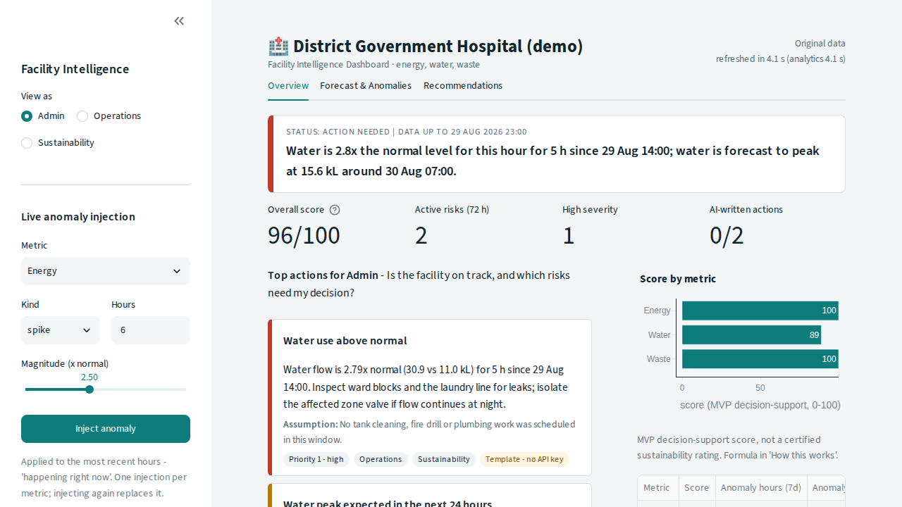

# Sustainable Facility & Estate Intelligence Dashboard — MVP

Government hospitals record energy, water and waste in separate registers and usually learn about a problem
from a complaint. This dashboard puts the three signals together, detects abnormal hours, forecasts the next
24 hours, and tells the facility manager in plain language what to do — **before the complaint, not after it.**



**Scope (PRD v1.0):** one district government hospital · `energy_kwh`, `water_kl`, `waste_kg` · hourly · 60 days of
synthetic data · 24 h forecast · decision support, **not** official measurement.

## Run it (4 commands)

```bash
python -m venv .venv
.venv\Scripts\activate            # macOS/Linux: source .venv/bin/activate
pip install -r requirements.txt
streamlit run app.py              # opens http://localhost:8501
```

The dataset is generated automatically on first start (or run `python scripts/generate_data.py`).
AI-written recommendations are optional: set `ANTHROPIC_API_KEY` (see `.env.example`). Without it the app runs
fully offline and every card is labelled **Template – no API key**.

Tests: `pytest` (140 tests, ~30 s, no network needed).

## How it works

```
generator.py ──► loader.validate ──► anomaly.py (hour-of-day z) ─┐
 (+ ground truth)                   forecasting.py (Holt-Winters) ┤
                                                                  ▼
                              compound.py ─► risk_events.py ─► scorecard.py      (AnalyticsResult)
                                                                  │
                          recommendations/ (template ─► Claude ─► validated JSON, fallback on any failure)
                                                                  │
                          app.py + dashboard/ (Overview · Forecast & Anomalies · Recommendations · How this works)
```

| Stage | Method |
|---|---|
| Data | Hourly hospital profiles (OPD energy peak, bathing/laundry/evening water peaks, rounds/meal waste peaks), Saturday half-day / Sunday OPD closed, day-to-day level variation, AR(1) meter noise, slight pre-summer energy trend. 8 anomalies injected on known days → `data/injected_anomalies.csv` ground truth. |
| Anomaly detection | Each hour is compared with the **same hour** on the previous 7 days (current hour excluded), weekday-adjusted, spread pooled over ±1 h, std floor 2 % of the mean, hours already flagged removed from later baselines. Anomalous if \|z\| ≥ 4.5. |
| Forecast | Holt-Winters: additive level, damped additive trend, additive 24 h season, fitted on the last 28 days. Band = ŷ ± 1.96 × robust residual σ (1.4826 × MAD). Seasonal-naive fallback if the fit fails. |
| Risks | Consecutive anomalous hours (gaps ≤ 2 h bridged) = **one incident**; active if it ends in the last 72 h. Forecast risk if the next-24 h peak > 1.10 × median daily peak of the last 7 days. Compound risk if ≥ 2 metrics are anomalous on the same day (rules-based, not a learned correlation model). |
| Scorecard | Metric = 100 − 40·min(1, anomaly h 7d / 24) − 60·min(1, max(0, % change last 7 d vs prior 21 d) / 30). Overall = mean − 10 per compound day (7 d), clipped 0–100. **MVP decision-support score, not a certified rating.** |
| Recommendations | Deterministic template filled with the evidence numbers (always available) → Claude rewrites action + assumption for the top 3 risks (4 s timeout, no retries, cached on evidence) → strict JSON validation. Any failure returns the template with the reason shown on the card. |

## Results (seed 42, 60 days, `python scripts/evaluate_detection.py`)

| z threshold | recall (8 windows) | hour precision | flagged hours | false-positive hours |
|---:|---:|---:|---:|---:|
| 3.0 (PDF default) | 1.00 | 0.32 | 133 | 91 |
| 3.5 | 1.00 | 0.57 | 74 | 32 |
| 4.0 | 1.00 | 0.76 | 55 | 13 |
| **4.5 (selected)** | **1.00** | **0.91** | **46** | **4** (of 4,320 scored) |
| 5.0 | 1.00 | 0.98 | 43 | 1 |

4.5 was chosen by `python scripts/tune_threshold.py`, which averages over 5 generator seeds (4.5: recall 1.00,
precision 0.86, 0.16 % of normal hours flagged) and also requires every demo scenario and live injection to be
clearly visible: at least 70 % of the modified hours flagged. At 5.0 the missed-pickup scenario drops to 57 %
coverage, so 5.0 fails that rule even though its precision is higher.

Live loop (inject -> analytics -> recommendations, templates): 0.8-0.9 s (`python scripts/benchmark.py`);
about 2.3 s from click to updated screen in the browser.

## Design decisions (A1–A12)

| # | Decision |
|---|---|
| A1 | Energy, water, waste only. Air quality and traffic are future work. |
| A2 | 24 h horizon (`HORIZON_H`). |
| A3 | Hour-of-day z-score, previous 7 days, current point excluded; weekday-adjusted, pooled spread, flagged hours excluded from later baselines; \|z\| ≥ 4.5 (tuned). |
| A4 | A metric is anomalous on a day with ≥ 1 anomalous hour; ≥ 2 metrics = compound day. |
| A5 | Forecast risk: next-24 h peak > 1.10 × median daily peak of the last 7 days. |
| A6 | Scorecard formula above, visible in the UI. |
| A7 | Injection = live recompute; scenarios = toggles, precomputed into the cache at start-up. |
| A8 | Units per hour: kWh, kL, kg generated. No tank level. |
| A9 | Template fallback is a requirement and is always wired in. |
| A10 | Role views = one analytics result, three lenses (Admin sees every high-severity risk). |
| A11 | "Processing" = validation, continuous hourly index, derived aggregates; synthetic data is clean by construction. |
| A12 | ≤ 3 LLM calls per refresh, concurrent, 4 s timeout, cached; templates never wait for the LLM. |

Full rationale and every deviation from the phase-procedure PDF: [`docs/BUILD_SPEC.md`](docs/BUILD_SPEC.md).

## Limitations and future work

Synthetic data; rules-based compound risk instead of a learned multivariate model; a drop is typed with the same
risk type as a rise (direction is shown); the forecast band is approximate and constant-width; one facility.
Next: real meters, many facilities with a database and scheduler, air quality, learned correlations,
IsolationForest as a drop-in detector comparison.
